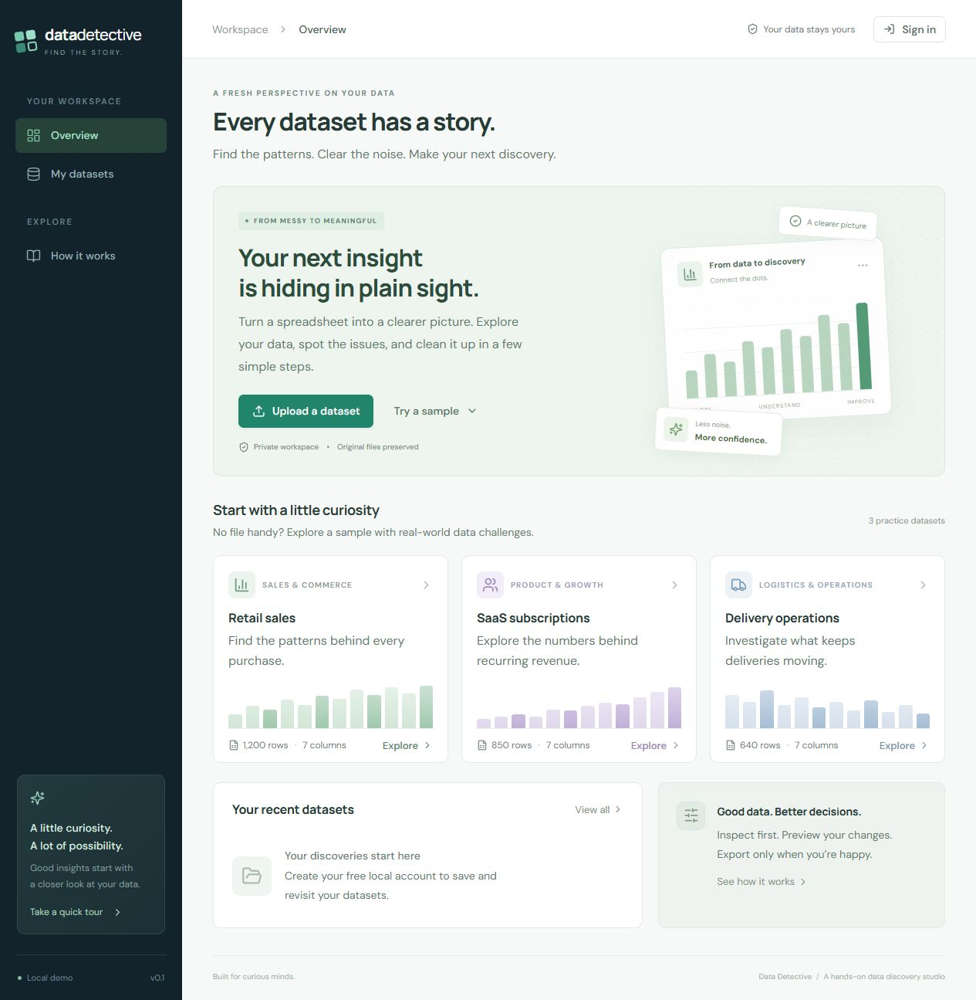

# Data Detective

Source: [JABDEVSA/JABDEVSADemoApp](https://github.com/JABDEVSA/JABDEVSADemoApp) · Working branch: `jab/data-detective`

A local portfolio application for exploring and cleaning CSV datasets. React + TypeScript provides the interface, Java owns the POST-only API and authentication, Python performs analysis, and SQLite stores accounts, sessions and original datasets.

## Try the demo

Run the app locally using the steps below, create an account, and open **Retail sales**. Inspect the health report, search for **Gauteng** in **Explore data**, sort by revenue, then preview trimming and deduplication in **Clean & export** before downloading the result. You can also upload your own CSV or explore subscription and delivery datasets.

The repository includes synthetic sample data only. Accounts, session tokens, uploaded datasets, local machine settings and runtime logs are excluded from Git. This repository contains the source; it does not host a live public application.

## Run locally on Windows

Prerequisites: Java 17+ (`java` and `javac`), Node.js and pnpm, and Python 3.10+. No Python packages are needed.

1. Run `pnpm install` from this directory.
2. Run `./scripts/setup-java.ps1` to fetch the pinned SQLite JDBC, Gson and SLF4J dependencies from Maven Central and verify their published checksums.
3. If Python is not on PATH, create the ignored `api/appsettings.Local.json` with `{"Python":{"Executable":"C:/path/to/python.exe"}}`. All runtime settings belong in appsettings files; no environment configuration is required. `api/appsettings.json` contains the single database path.
4. Run `./scripts/start-api.ps1` in one terminal. It compiles the Java source for local development and serves `http://127.0.0.1:5088`.
5. Run `pnpm dev` in another terminal. Open `http://127.0.0.1:5188`. Vite proxies `/api` to Java.
6. Create your account, choose a sample or upload a CSV, inspect it, then preview cleaning and download the result.

The active local session uses a bundled Python executable recorded only in ignored local settings. Java source is compiled to ignored api/classes. Dependency jars live in ignored api/lib. SQLite creates ignored api/data/detective.db. Runtime logs live in ignored .runtime. The servers started during implementation are hidden processes, with their launcher IDs in .runtime/processes.json.

## Check locally

- `pnpm check`: TypeScript type checking, without a frontend production build.
- `python -m unittest discover -s python -p "test_*.py" -v`: analysis tests.
- With the API running: `python -m unittest discover -s tests -p "test_*.py" -v`: real SQLite/API integration tests. The tests create two unique accounts and remove only those exact account IDs and their sessions/datasets.

Replace `python` with the configured Python executable if needed. Test results and browser evidence are recorded in evidence/verification.md.

## Structure

| Location | Responsibility |
|---|---|
| src/main.tsx / src/App.tsx | Stable React root; typed views, authentication dialogs and interaction state |
| src/types.ts / src/api.ts | Shared UI data contracts and POST client |
| src/styles.css / DESIGN.md | Responsive visual baseline and design decisions |
| api/src/Main.java | Java HTTP server, authentication, ownership, persistence orchestration and bounded Python execution |
| python/engine.py | Strict CSV parsing, profiling, IQR outliers, aggregation, search/sort/page, cleaning and spreadsheet-safe export |
| database/schema.sql | Independent users, sessions and datasets tables |
| database/queries | Individual parameterised SQL scripts, including explicitly named test fixture cleanup/read scripts |
| HISTORY.md / ACTIONS.md | Scope, evidence, remaining work and handoff |

## Design decisions and limits

- Java uses the JDK HTTP server, JDBC and a small JSON library; there is no framework dependency or hidden external analysis service.
- Passwords use salted PBKDF2-HMAC-SHA256 with 600,000 iterations. Sessions use random opaque cookies and only a SHA-256 token hash is persisted. Cookies are HttpOnly, SameSite=Strict and expire after 24 hours. The local loopback HTTP demo uses SecureCookies=false; a future HTTPS deployment requires that setting to be true.
- Only POST JSON requests are accepted. Browser origins are explicitly allowlisted. Dataset ownership is checked for every read, preview and export.
- Login/register requests have a 20-attempt/5-minute per-address limit. Analysis has four worker slots, a 25-second timeout and bounded input. This is a local demo, not production infrastructure.
- SQLite explicitly replaces the user's general MSSQL requirement. Because SQLite has no stored procedures, individual SQL scripts are used instead; application source contains no SQL statements.
- Every new application timestamp is written with an explicit +02:00 offset using Africa/Johannesburg; displayed times use the same named timezone. CSV date-only values are preserved.
- Original CSVs remain unchanged. Exports prefix formula-like strings for safer spreadsheet use. Outliers are never automatically removed. Missing-value replacement is explicitly user selected and may change inferred column types.
- Limits: 1 MB UTF-8 CSV, 20,000 rows, 80 columns, 30 datasets per account. No password reset, email verification, multi-user collaboration or reviewer-rating system was requested or added.
- Source publication, deployment and CTO visual acceptance are separate from local functional evidence. Public GitHub publication is authorised; no live application deployment is included.
